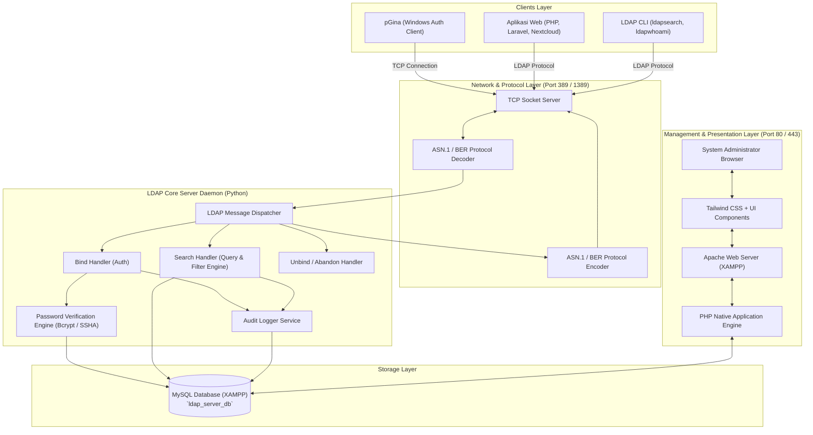
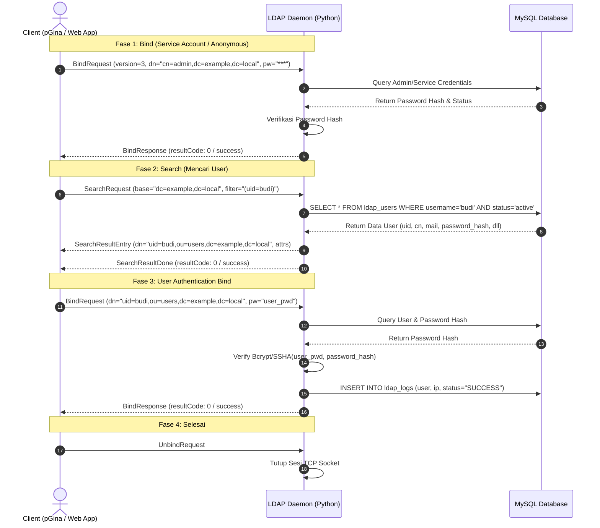

# Arsitektur Sistem (Architecture Document) - Custom LDAP Server

Dokumen ini menguraikan arsitektur teknis, desain modul, alur data protokol, dan topologi jaringan dari **Custom LDAP Server**.

---

## 1. Diagram Arsitektur Tingkat Tinggi (High-Level Architecture)



---

## 2. Rincian Lapisan Arsitektur (Layer Breakdown)

### 2.1 Protocol & Network Layer (TCP Listener)
- **Protokol Dasar**: TCP RFC 4511.
- **Port Default**: `389` (LDAP standar) dan opsi port fallback `1389` / `3890`.
- **Enkoding Pesan**: **ASN.1** (*Abstract Syntax Notation One*) menggunakan aturan **BER** (*Basic Encoding Rules*).
- **Struktur Pesan LDAP**:
  ```
  LDAPMessage ::= SEQUENCE {
      messageID       MessageID,
      protocolOp      CHOICE {
          bindRequest         BindRequest,
          bindResponse        BindResponse,
          unbindRequest       UnbindRequest,
          searchRequest       SearchRequest,
          searchResEntry      SearchResultEntry,
          searchResDone       SearchResultDone,
          ...
      },
      controls        [0] Controls OPTIONAL
  }
  ```

---

### 2.2 Core Message Dispatcher & Handlers



---

### 2.3 Directory Information Tree (DIT) Mapping

Struktur DIT LDAP yang diproyeksikan secara virtual dari database relasional:

```
dc=example,dc=local  (Base DN / Root)
│
├── cn=admin  (Root / Service Bind Account)
│
├── ou=users  (Organizational Unit: Pengguna)
│   ├── uid=budi,ou=users,dc=example,dc=local
│   ├── uid=siti,ou=users,dc=example,dc=local
│   └── uid=ahmad,ou=users,dc=example,dc=local
│
└── ou=groups (Organizational Unit: Kelompok/Role)
    ├── cn=administrators,ou=groups,dc=example,dc=local
    ├── cn=staff,ou=groups,dc=example,dc=local
    └── cn=developers,ou=groups,dc=example,dc=local
```

---

### 2.4 Storage Layer (MySQL Relational Schema)
Penyimpanan menggunakan MySQL/MariaDB yang sudah ada di XAMPP:
- **Pemisahan Logis**: Tabel dipisah secara relasional untuk performa kueri cepat dengan indeks pada `username`, `email`, dan `status`.
- **Virtual DIT Projection**: Daemon secara otomatis menyusun Distinguished Name (`DN`) berdasarkan konfigurasi `base_dn` dan nama entitas.

---

### 2.5 Presentation Layer (Web Admin Dashboard)
- **Teknologi**: PHP 8.x Native (OOP & Procedural murni tanpa framework berat) + Tailwind CSS (Modern UI via CDN & Custom Stylesheet).
- **Keamanan Web**:
  - Session-based Authentication dengan token CSRF pada setiap form mutating (POST/PUT/DELETE).
  - Sanitasi input dan Output Encoding untuk mencegah XSS.
  - PDO Prepared Statements untuk mencegah SQL Injection.
  - Middleware otorisasi di setiap route admin.
