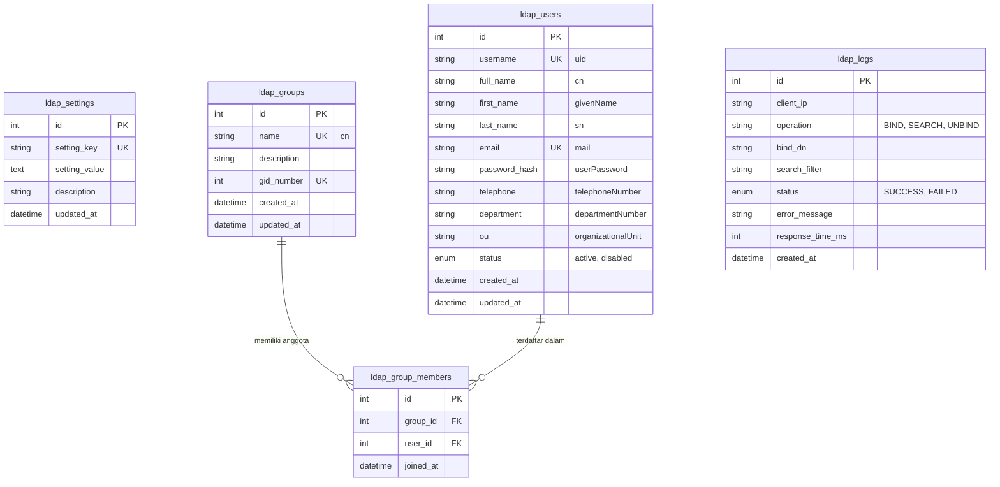

# Spesifikasi Basis Data (Database Documentation)

Dokumen ini menjelaskan struktur skema basis data MySQL untuk **Custom LDAP Server**.

- **Nama Database Default**: `ldap_server_db`
- **Engine**: `InnoDB`
- **Karakter Set / Collation**: `utf8mb4 / utf8mb4_unicode_ci`

---

## 1. Diagram Relasi Entitas (ERD)

---

## 2. Rincian Struktur Tabel

### 2.1 Tabel `ldap_settings`
Menyimpan variabel konfigurasi global server LDAP.

| Nama Kolom | Tipe Data | Nullable | Default | Deskripsi |
| :--- | :--- | :--- | :--- | :--- |
| `id` | `INT UNSIGNED` | NO | AUTO_INCREMENT | Kunci Utama |
| `setting_key` | `VARCHAR(64)` | NO | - | Nama kunci setting (UNIQUE) |
| `setting_value` | `TEXT` | YES | NULL | Nilai konfigurasi |
| `description` | `VARCHAR(255)` | YES | NULL | Penjelasan konfigurasi |
| `updated_at` | `DATETIME` | NO | CURRENT_TIMESTAMP | Waktu terakhir diperbarui |

**Kunci Konfigurasi Standar**:
- `base_dn`: Base DN direktori (contoh: `dc=internal,dc=net` atau `dc=example,dc=local`).
- `admin_bind_dn`: DN akun root/service (contoh: `cn=admin,dc=internal,dc=net`).
- `admin_password_hash`: Hash password untuk akun admin/service bind.
- `allow_anonymous_bind`: `1` (diizinkan) atau `0` (wajib bind terautentikasi).
- `ldap_port`: Port listener daemon (contoh: `389` atau `1389`).
- `user_ou`: OU default pengguna (contoh: `ou=users`).
- `group_ou`: OU default grup (contoh: `ou=groups`).

---

### 2.2 Tabel `ldap_users`
Menyimpan akun pengguna dan pemetaan atribut LDAP standar.

| Nama Kolom | Tipe Data | Nullable | Default | Pemetaan LDAP RFC |
| :--- | :--- | :--- | :--- | :--- |
| `id` | `INT UNSIGNED` | NO | AUTO_INCREMENT | - |
| `username` | `VARCHAR(64)` | NO | - | `uid`, `sAMAccountName` (UNIQUE) |
| `full_name` | `VARCHAR(128)` | NO | - | `cn`, `displayName` |
| `first_name` | `VARCHAR(64)` | YES | NULL | `givenName` |
| `last_name` | `VARCHAR(64)` | YES | NULL | `sn` |
| `email` | `VARCHAR(128)` | YES | NULL | `mail` (UNIQUE) |
| `password_hash` | `VARCHAR(255)` | NO | - | `userPassword` |
| `telephone` | `VARCHAR(32)` | YES | NULL | `telephoneNumber` |
| `department` | `VARCHAR(64)` | YES | NULL | `departmentNumber` |
| `ou` | `VARCHAR(64)` | NO | `users` | `ou` |
| `status` | `ENUM('active','disabled')` | NO | `'active'` | Validasi login |
| `created_at` | `DATETIME` | NO | CURRENT_TIMESTAMP | `createTimestamp` |
| `updated_at` | `DATETIME` | NO | CURRENT_TIMESTAMP | `modifyTimestamp` |

---

### 2.3 Tabel `ldap_groups`
Menyimpan kelompok/role pengguna untuk otorisasi berbasis grup.

| Nama Kolom | Tipe Data | Nullable | Default | Pemetaan LDAP RFC |
| :--- | :--- | :--- | :--- | :--- |
| `id` | `INT UNSIGNED` | NO | AUTO_INCREMENT | - |
| `name` | `VARCHAR(64)` | NO | - | `cn` (UNIQUE) |
| `description` | `VARCHAR(255)` | YES | NULL | `description` |
| `gid_number` | `INT UNSIGNED` | YES | NULL | `gidNumber` (posixGroup) |
| `created_at` | `DATETIME` | NO | CURRENT_TIMESTAMP | - |
| `updated_at` | `DATETIME` | NO | CURRENT_TIMESTAMP | - |

---

### 2.4 Tabel `ldap_group_members`
Tabel relasi many-to-many antara pengguna dan grup.

| Nama Kolom | Tipe Data | Nullable | Default | Deskripsi |
| :--- | :--- | :--- | :--- | :--- |
| `id` | `INT UNSIGNED` | NO | AUTO_INCREMENT | Kunci Utama |
| `group_id` | `INT UNSIGNED` | NO | - | FK ke `ldap_groups.id` |
| `user_id` | `INT UNSIGNED` | NO | - | FK ke `ldap_users.id` |
| `joined_at` | `DATETIME` | NO | CURRENT_TIMESTAMP | Waktu ditambahkan |

*Constraint*: `UNIQUE(group_id, user_id)`, `FOREIGN KEY (group_id) REFERENCES ldap_groups(id) ON DELETE CASCADE`, `FOREIGN KEY (user_id) REFERENCES ldap_users(id) ON DELETE CASCADE`.

---

### 2.5 Tabel `ldap_logs`
Menyimpan riwayat audit autentikasi dan pencarian LDAP secara terperinci.

| Nama Kolom | Tipe Data | Nullable | Default | Deskripsi |
| :--- | :--- | :--- | :--- | :--- |
| `id` | `BIGINT UNSIGNED` | NO | AUTO_INCREMENT | Kunci Utama |
| `client_ip` | `VARCHAR(45)` | YES | NULL | Alamat IP Klien (IPv4/IPv6) |
| `operation` | `VARCHAR(32)` | NO | - | BIND, SEARCH, UNBIND, dll. |
| `bind_dn` | `VARCHAR(255)` | YES | NULL | Target DN yang diminta |
| `search_filter` | `TEXT` | YES | NULL | String filter kueri LDAP |
| `status` | `ENUM('SUCCESS','FAILED')` | NO | - | Status hasil operasi |
| `error_message` | `VARCHAR(255)` | YES | NULL | Keterangan jika gagal |
| `response_time_ms`| `INT UNSIGNED` | YES | 0 | Waktu pemrosesan (ms) |
| `created_at` | `DATETIME` | NO | CURRENT_TIMESTAMP | Waktu pencatatan log |

---

## 3. Data Awal Default (Seed Data)

Saat database pertama kali dibuat:
1. **Pengaturan Awal (`ldap_settings`)**:
   - `base_dn` = `dc=internal,dc=net`
   - `admin_bind_dn` = `cn=admin,dc=internal,dc=net`
   - `admin_password_hash` = Hash Bcrypt dari `admin123`
   - `allow_anonymous_bind` = `1`
   - `ldap_port` = `389`
2. **Grup Bawaan (`ldap_groups`)**:
   - `Administrators` (gid: 500)
   - `Staff` (gid: 501)
   - `Developers` (gid: 502)
3. **Pengguna Bawaan (`ldap_users`)**:
   - `admin` (Full Name: System Administrator, email: admin@internal.net, password: `adminpassword`)
   - `user1` (Full Name: John Doe, email: john@internal.net, password: `password123`)
